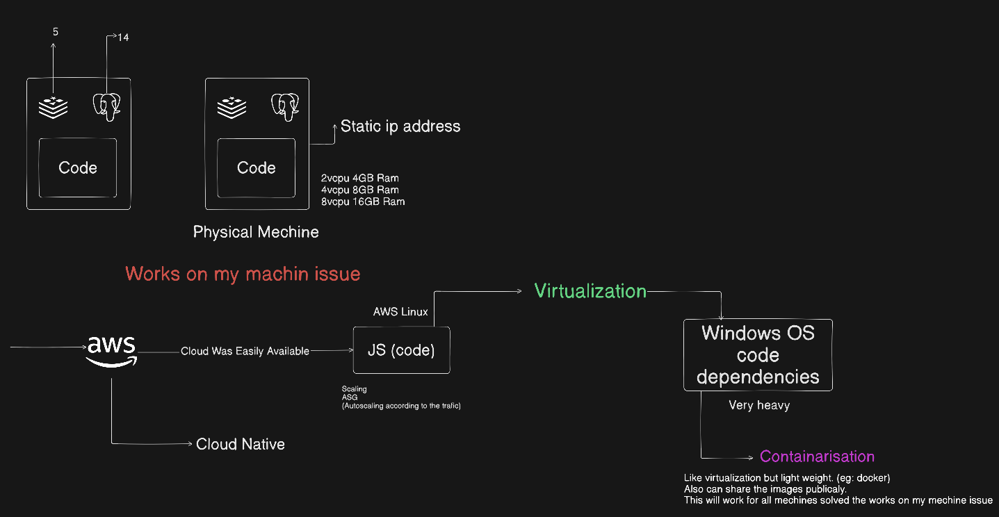
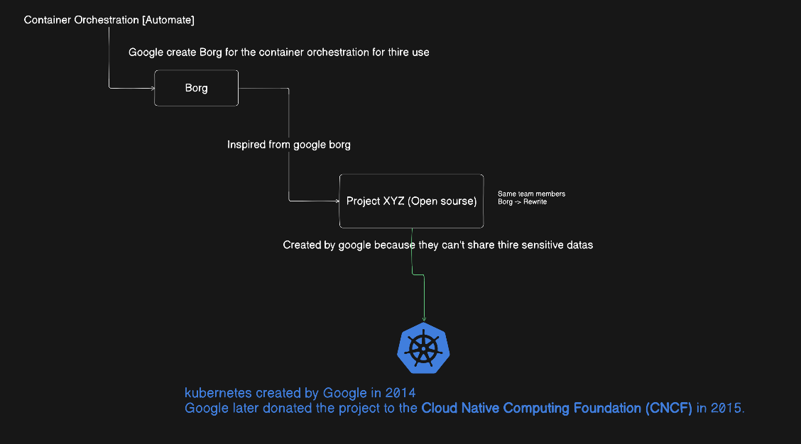
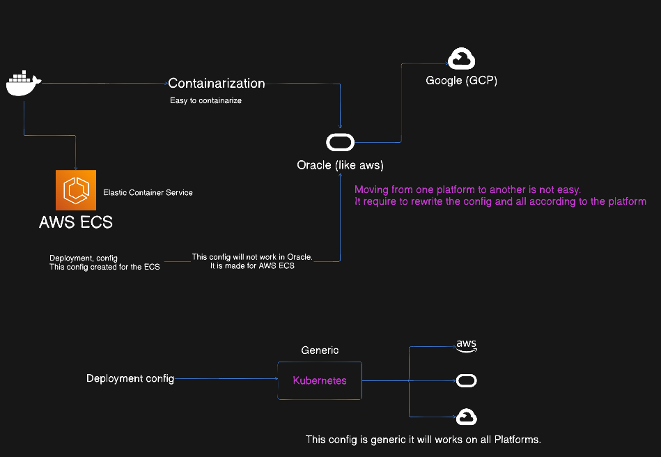

#   KUBERNETES - Complete Documentation
This documentation covers everything you need to know about Kubernetes. While it is mostly known for organizing containers, it is a powerful tool that automatically handles the deployment, scaling, and management of your applications. After reading this, you will fully understand how to use it to keep your projects running smoothly and reliably.

## What is kubernetes ?
Kubernetes also known as K8s, is an open sourse system for automating deployment, scaling and management of containarized applications.

# Les't understand the History

## Evolution of Infrastructure

We started the web hosting in our own physical mechines. We did everithing by hand, which cause the "It works on my mechine issue!" headache because every computer was set up differently.

When the AWS become famous and the cloud becomes easy to reach, we moved our work to the cloud. We used AWS Linx, but we still doing all the hard work of managing the code and servers manualy.

To fix our environment problems, we started using Virtualization. We putt apps into Virtual Mechines, but this was heaby and slow because every single app hard to carry the weight of and entire operating system.

Because Virtualization was too heavy, we switched to containers (eg: docker now we uses). This was the turning poin containers gave us the same isolation as birtual machines but were lightweight, easy to share, and finaly killed the "it works on my mechine" issue.

Finally we moved to the Cloud Native model. When we began running many containers, we used the tools like ASG to handle the traffic automatically, This entire journey created the clear need for the smart automation we now call Kubernetes.

## What is Container Orchestration ?

Orchestration is the automated arrangement, coordination, and management of complex systems. 
eg : Think of a musical conductor leading an orchestra: the conductor doesn't play every instrument themselves, but they ensure every musician starts, stops, and plays in harmony to create a single, cohesive performance.

Container orchestration applies this same concept to software. It is a system that automatically manages your containers so you do not have to do it by hand.
Think of it as a "manager" or a "brain" for your containers:

* Automation: It handles tasks like running, restarting, and checking the health of containers automatically.
* Coordination: It arranges many containers to work together as one smooth, reliable system.
* Scaling: If your app gets busy, it can automatically add more containers to handle the traffic, and remove them when they are no longer needed.

## The Scaling Trap: The Real Problem

After we moved to the cloud and used auto-scaling, we hit a wall. We solved portability, but we created a huge management headache.

The Daily Struggle: Even with automation like ASG, we were still manually "babysitting" every single container. Our non-stop task list included:

* Running and destroying containers.
* Monitoring logs for every single container.
* Restarting containers that crashed.
* Running health checks to see if they were actually working.

The Hiring Trap: We thought adding more developers would fix it, but that was a mistake. It was not cost-effective, and the work remained slow, manual, and prone to human error.

The Breaking Point: We were stuck doing manual work at a scale no human could handle. We realized we couldn't keep adding people to do work that software should be doing for us.

## The Invention of Kubernetes 🔥

Google's Secret: Google created a tool for container orchestration for their internal use called Borg.

The Problem: Borg was too secret and connected to Google's private data to share, so other developers couldn't use it.

The Rewrite: The same team that created Borg built a new open-source project, inspired by Borg's ideas, and rewrote the code from scratch.

The Birth of Kubernetes: In 2014, Google created this tool, called Kubernetes.

The Gift to the World: In 2015, Google donated the project to the Cloud Native Computing Foundation (CNCF).

## We Chose Kubernetes ?

The core difference between a platform-native orchestrator (like AWS ECS) and Kubernetes is the level of infrastructure abstraction.

**Platform-Native Orchestration (e.g., AWS ECS)**

* Coupled Configuration: Deployment manifest definitions are tightly bound to proprietary APIs and platform-specific infrastructure conventions.
* Vendor Lock-in: Migrating between cloud providers is labor-intensive, as it requires a complete refactor of deployment configurations to align with the new platform’s orchestration logic.
* Zero Portability: Since the configuration is native to one service, it cannot be reused across heterogeneous cloud environments like GCP or Oracle.

**Kubernetes (Standardized Orchestration)**

* Universal API: Kubernetes provides a consistent, vendor-agnostic abstraction layer, allowing you to use a unified YAML schema across any environment.
* "Write Once, Deploy Anywhere": Once your deployment manifest is defined for Kubernetes, it is portable and will function consistently on AWS, GCP, Oracle, or on-premises infrastructure without modification.
* Strategic Flexibility: Decoupling your application from the underlying provider prevents vendor lock-in, granting you the architectural freedom to shift workloads based on cost, performance, or availability.

[Kubernetes Architecture Details](kubernetes-architecture.md)